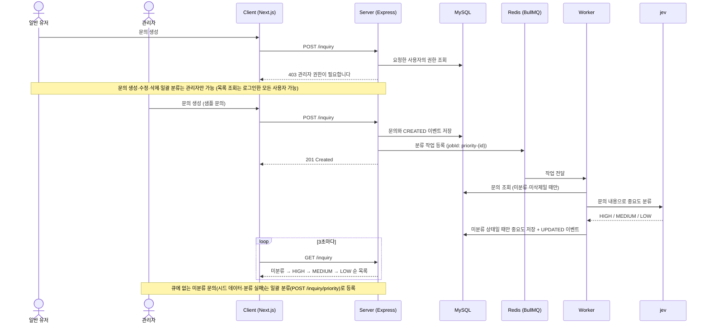

# AI Inquiry Admin

AI가 고객 문의를 중요도(HIGH / MEDIUM / LOW)로 자동 분류해, 급한 문의부터 보여 주는 관리자 서비스

- **Client**: Next.js 16, React 19, Zustand, axios, Tailwind CSS
- **Server**: Express 5, Drizzle ORM, MySQL, Redis, BullMQ, JWT, Zod
- **AI**: TypeSafe AI SDK (jev)

## 전체 흐름



## AI 분류 정확도

AI 분류 결과는 사람이 따로 검토하지 않으므로, 정답셋을 만들어 정확도 측정 (`server/src/eval/priority.ts`)

- 정답셋: 50건 (HIGH 17 / MEDIUM 16 / LOW 17)
- 헷갈리기 쉬운 문의 포함: 말투와 실제 긴급도가 다른 문의, "결제"·"보안"이 들어갔지만 급하지 않은 문의, 분류를 조작하려는 문의
- 결과: 반복 실행 시 대부분 50/50, 가끔 환불 지연 문의가 MEDIUM으로 분류되어 49/50
- 개선: jev에 넘기는 HIGH 설명에 "환불 오류"를 추가한 뒤 50/50

## 실행 방법

```bash
# .env (루트): Docker로 MySQL을 띄울 때 사용
MYSQL_ROOT_PASSWORD=<MySQL root 비밀번호>

# server/.env: DATABASE_URL의 비밀번호는 MYSQL_ROOT_PASSWORD와 동일
DATABASE_URL=mysql://root:<MYSQL_ROOT_PASSWORD>@localhost:3306/ai_inquiry_admin
JWT_SECRET=<임의의 문자열>
TYPESAFE_API_KEY=<TypeSafe AI API 키>
REDIS_URL=redis://localhost:6379

# client/.env
NEXT_PUBLIC_API_URL=http://localhost:8000
```

```bash
# MySQL, Redis 실행
docker compose up -d

# 서버
cd server
pnpm install
pnpm seed              # 마이그레이션 적용 + 테스트 데이터 생성 (기존 데이터는 초기화)
# 테스트 계정: `admin01@test.com` / `1234` (관리자), `user01@test.com` / `1234` (유저)
pnpm dev               # http://localhost:8000

# 클라이언트
cd client
pnpm install
pnpm dev               # http://localhost:3000
```
